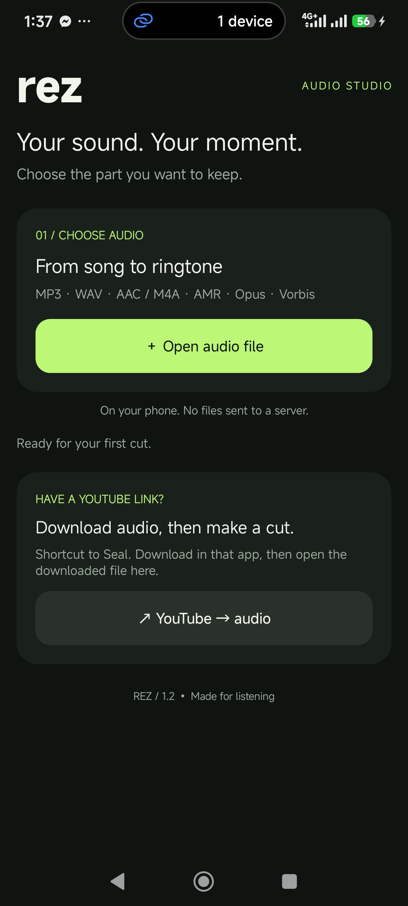
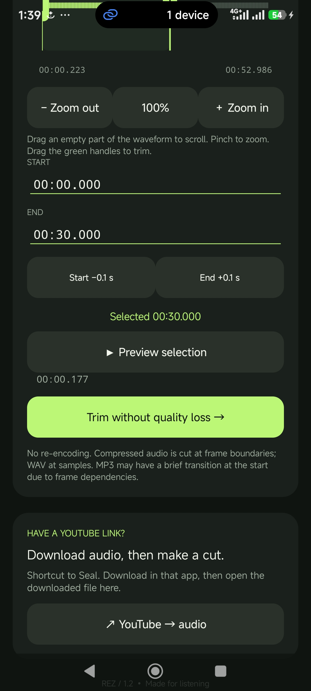

# Rez Audio Studio v1.2

## Overview

Rez Audio Studio is an Android application for trimming audio recordings and creating ringtones. Audio is processed locally on the device, without an account or advertisements.

The application requires **Android 10 or later (API 29+)**. Version 1.2 uses application ID `rs.rez.audio`, version code `3`, and target SDK `35`.

The production-signed v1.2 APK is publicly available from [Release v1.2](https://github.com/novipiksel-alt/Rez-Audio-Studio/releases/tag/v1.2). It passed the guided Xiaomi 12 workflow test; the public download was independently retrieved without authentication and matched the approved APK. See the [release verification](docs/FINAL-v1.2.md) for fingerprints and test limits.

## Features

- Import audio through the Android file picker or sharing from another application.
- View the waveform, zoom with buttons or a pinch gesture, and scroll horizontally.
- Select a time range using the handles or time fields, then preview the selection.
- Trim supported audio without re-encoding.
- Save clips to `Music/Rez` or `Ringtones/Rez`.
- Open, share, or rename saved clips, and optionally set a clip as the ringtone.
- Open the separately installed Seal application through a YouTube link shortcut.

Supported formats and output behavior:

| Audio format | Export behavior |
| --- | --- |
| MP3 | Copies compressed frames to an MP3 file. |
| PCM and floating-point WAV | Copies audio samples to a WAV file. Compressed WAV is not supported. |
| ADTS AAC | Copies compressed frames to an AAC file. |
| AAC in M4A | Uses Android media APIs to remux into M4A. |
| AMR-NB and AMR-WB | Uses Android media APIs to remux into 3GP. |
| Opus and Vorbis | Uses Android media APIs to remux into WebM. |

FLAC and ALAC are not supported for trimming in this version. Platform-based playback and remuxing depend on the device's media support. Compressed audio cuts follow frame or packet boundaries, so the actual range can differ slightly from the selection. MP3 frame dependencies may cause a brief transition at the start. WAV cuts follow sample boundaries. Import is limited to 2 GB and available cache storage; WAV export is subject to the format's 4 GB limit. Encrypted audio is not supported.

## Screenshots

**Home screen** — Open an audio file or access the shortcut to the separate Seal app.



**Audio editor** — Adjust the selection, preview audio, and trim without re-encoding.



## Supported Languages

The interface supports **English, Bosnian, German, Italian, and Spanish**. Android selects the language automatically from the system configuration. English is the default fallback; there is no separate in-app language selector.

Translations cover controls, dialogs, notifications, errors, and accessibility descriptions. Resources are stored in `app/src/main/res/values/strings.xml` and the `values-bs`, `values-de`, `values-it`, and `values-es` directories. Time fields retain the `mm:ss.SSS` format and also accept a decimal comma.

## Installation

Download [Rez-Audio-Studio-v1.2.apk](https://github.com/novipiksel-alt/Rez-Audio-Studio/releases/download/v1.2/Rez-Audio-Studio-v1.2.apk) (103095 bytes) and its [SHA-256 checksum](https://github.com/novipiksel-alt/Rez-Audio-Studio/releases/download/v1.2/Rez-Audio-Studio-v1.2.apk.sha256). APK SHA-256: `9922af6503b858da5cac39e395ddab8bdd42d14c05873aba875089299a805922`. The previous attachment was withdrawn, then replaced with this verified APK after owner approval.

Obtain the APK and its SHA-256 checksum from [Release v1.2](https://github.com/novipiksel-alt/Rez-Audio-Studio/releases/tag/v1.2), verify the download, and open it on an Android 10+ device. Android may require permission for the application used to install the APK.

For local development, the build script produces `dist/Rez-1.2.apk`, signed with a development certificate. This is not the production release. An installation signed with a different certificate cannot be upgraded directly using the production APK. Do not replace an existing installation without considering its data and signing identity. On Xiaomi 12, the existing installation could not be upgraded because its certificate differed. It was uninstalled with the owner's explicit approval, then the exact new production APK was installed and tested. Existing users of the old signing identity need to preserve their work before uninstalling; the new certificate cannot upgrade the old identity.

## Usage

1. Open an audio file through the file picker, or share an audio file to Rez.
2. Zoom or scroll the waveform and choose the start and end points. You can also enter the times directly.
3. Preview the selection, then trim it.
4. Choose a clip name and save. The original file remains unchanged.
5. Open, share, or rename the saved clip, or set it as a ringtone.

Setting a ringtone may require Android's permission to modify system settings. If permission is denied, the saved clip remains available and the ringtone is not changed.

## Building from Source

The documented manual build targets Linux and requires:

- JDK 17.
- Android SDK Platform 36 and Build Tools 36.0.0.
- Bash, Python 3, `zip`, and `ripgrep` for the build and preparation scripts.
- FFmpeg and ffprobe for test fixtures and independent audio checks.

Set `ANDROID_SDK_ROOT` to your SDK installation, then run:

```bash
./scripts/build.sh
```

The script creates a local development key at `build/manual/debug.keystore` if needed and writes `dist/Rez-1.2.apk`. Never include this key in Git or release attachments.

To build without generating or using a signing key:

```bash
./scripts/build.sh --unsigned
```

The unsigned output is `dist/Rez-1.2-unsigned.apk`. Gradle configuration is provided, but the manual build is the validated path; a Gradle wrapper is not included, and Gradle/lint validation remains outstanding.

Production signing uses a separate key outside the repository. The required certificate identity is `CN=Rez Audio Studio, O=Rez Audio Studio, C=BA`. Follow the [release procedure](docs/RELEASE-PROCESS.md) for key storage, backup, signing, certificate verification, and final approval. Private keys and passwords must never be included in the repository or release package.

## Testing

Run the local test suite:

```bash
./scripts/test.sh
```

The recorded results are **124 Java assertions** and **54 independent FFmpeg checks**, plus localization checks. Audio checks cover decoding, timing, format preservation, and unchanged packet or PCM content. Synthetic test audio is generated locally; binary fixtures are excluded from the source package.

Check translation catalogs and the languages embedded in a built APK:

```bash
python3 tests/verify_localization.py
python3 tests/verify_localization.py dist/Rez-1.2.apk
```

Android instrumentation tests are available through `scripts/test-device.sh`. They require ADB and a dedicated Android 10+ test device. The script installs development and test APKs, so do not run it against an installation that must be preserved, including the Xiaomi 12 installation used during this preparation.

**Tested on Xiaomi 12, Android 15 (14 November 2026):** the installed APK was pulled back through ADB and its SHA-256 matched the new production candidate. Guided manual testing passed file picker import, waveform, 400% zoom and horizontal panning, typed range selection, preview, trimming, saving, opening/playback and the system share chooser. The exported WAV contains the exact original PCM samples for the selected range; the original file and earlier exports remained unchanged. Nothing was sent through the share chooser.

Instrumentation coverage includes five languages, regional variants, English fallback, and controls at 320 dp with font scales of 100%, 150%, and 200%. The instrumentation suite was not executed against the production APK: it requires a separately signed test APK with a matching certificate. ADB inspection and guided manual testing were used instead. All five home screens and compiled language resources were checked; the full audio workflow was tested in Bosnian. The small-screen/font-scale instrumentation matrix remains unexecuted. See the [v1.2 review](docs/REVIEW-1.2.md) for results and remaining checks.

Prepare and scan the draft source package without publishing:

```bash
./scripts/package-source.sh
python3 scripts/verify-package-security.py dist/Rez-Audio-Studio-1.2-source-DRAFT.zip
```

## Seal Integration

The YouTube shortcut sends an HTTPS YouTube link to the **separately installed [Seal application](https://github.com/JunkFood02/Seal)**. Downloading takes place in Seal; return to Rez afterward and open the downloaded audio file.

**Seal is not included in the APK.** Rez does not bundle Seal's code, resources, or downloader. Download availability depends on Seal and the service involved. Only download content you have permission to use. Seal retains its own license; see [third-party notices](THIRD_PARTY_NOTICES.md).

## License

The project uses the **Apache License, Version 2.0**. See [LICENSE](LICENSE), [NOTICE](NOTICE), and [THIRD_PARTY_NOTICES.md](THIRD_PARTY_NOTICES.md).

The owner confirmed ownership or permission to publish the project code, tests, scripts, XML resources, vector icon and documentation screenshots under Apache-2.0 on 14 November 2026. This is an owner declaration, not independent proof of authorship. The owner approved the replacement production APK and public release; the public attachments were downloaded again and verified.

## Developer

**Developer:** Sn1p3r

This developer credit appears in documentation only. The production signing certificate uses the project identity specified above, without a developer alias or personal information.
